<p align="center">
  
</p>

<p align="center">
  <a href="https://fitjanta.onrender.com"></a>
</p>
<p align="center">
  
  
  
  
  
  
</p>

# 🏃 FitJanta — Move. Eat. Share.

A social fitness web app: log workouts and meals, let the **Food AI** work out the nutrition,
earn XP, take on challenges, claim territory on a live map and climb the leaderboard with friends.
Works on any phone and can be installed to the home screen.

## ✨ Features

| | Feature | What it does |
|---|---|---|
| 🏋️ | **Workout log** | Running, walking, cycling, yoga, swimming, workouts — distance, time, calories, XP |
| 🍛 | **Food AI** | Type a meal in plain words ("2 roti, dal, 1 bowl rice") → calories, protein, carbs, fat and a health score |
| 🏆 | **Challenges & XP** | Ready-made challenges (5 km walk, 10,000 steps, healthy plate…) with levels and day streaks |
| 🗺️ | **Live territory map** | Share your location, see athletes nearby and claim up to 2 km territories |
| 📸 | **Social feed** | Photo posts, comments and public athlete profiles |
| 📊 | **Leaderboard & dashboard** | Weekly summary, calories, XP progress and rankings |
| 📱 | **Phone ready** | QR page to open on a phone, permanent cloud link, PWA install |

## 🧱 Tech stack

- **Backend:** Java 17, Spring Boot (Web MVC, Data JPA, Security with BCrypt, Validation), Gradle
- **Database:** MySQL (photos stored in the `media` table)
- **Frontend:** HTML, CSS, JavaScript, Bootstrap 5, Bootstrap Icons
- **Cloud:** Docker image on Render + cloud MySQL (TiDB Cloud / Aiven)

## ▶️ Run locally

1. Start MySQL (Windows service `MYSQL80`).
2. Create `config/application.properties` (git-ignored) with your local login:
   ```properties
   spring.datasource.url=jdbc:mysql://localhost:3306/fitjanta?createDatabaseIfNotExist=true
   spring.datasource.username=root
   spring.datasource.password=YOUR_PASSWORD
   ```
3. Double-click **`start-fitjanta.bat`** — or run `./gradlew bootRun` — then open http://localhost:8080.
4. Open `/qr.html` and scan it to use the app on your phone (same Wi-Fi).

## ☁️ Deployment

`Dockerfile` + `render.yaml` deploy the app to Render. Database values (`DB_URL`, `DB_USER`, `DB_PASSWORD`)
are set in the Render dashboard, never in the code. `migrate-to-cloud.ps1` copies local MySQL data to the cloud database.

## 🗂️ Project structure

```
src/main/java/com/fitjanta/
  controller/   Users, Activities, Food, Challenges, Posts, Territories, Map, Leaderboard, Media
  service/      NutritionAiService, GeoService, ImageStorageService, ProfileService
  model/        JPA entities (MySQL tables)
src/main/resources/static/   HTML pages, css/, js/fitjanta.js
```

<p align="center"><sub>Built by <a href="https://github.com/tjsss10">Tejas Gavhane</a></sub></p>
